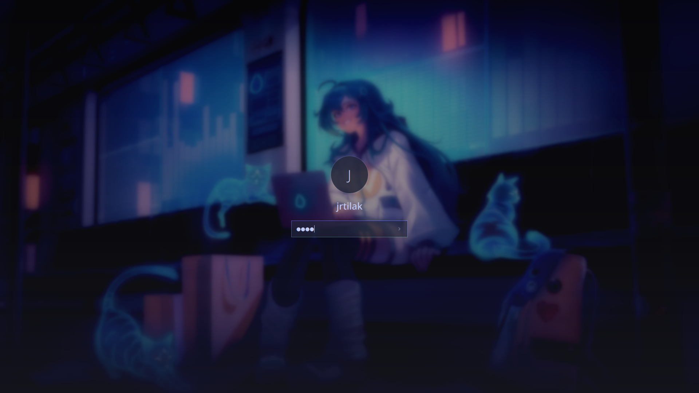
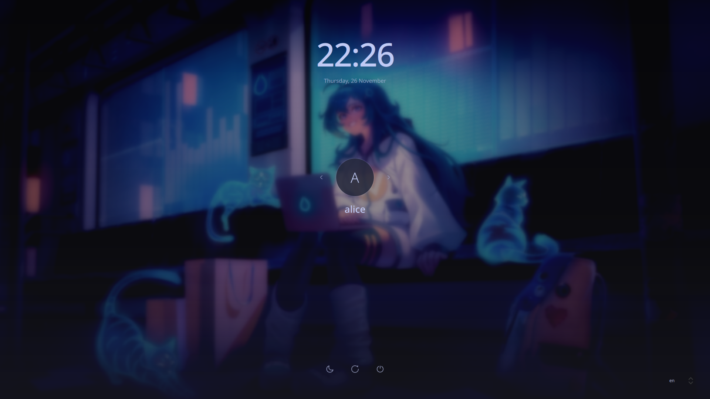
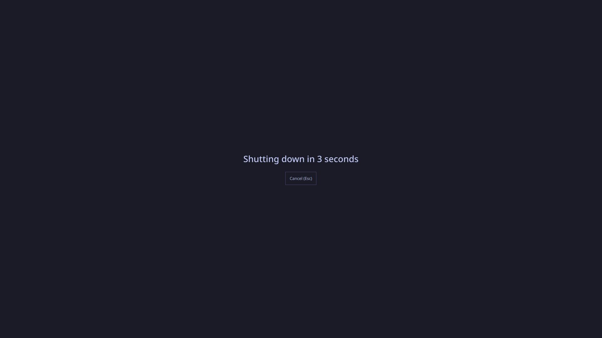

# Luna Login

A minimal SDDM login screen with user, session, and keyboard layout selection.
Luna's desktop session adds startup recovery, keyring initialization, application restoration.

Installation activates the screen for the next login without ending the current
session. See [DOCS.md](DOCS.md).

| Resting | Password |
| --- | --- |
|  |  |
| User switcher | Shutdown |
|  |  |
